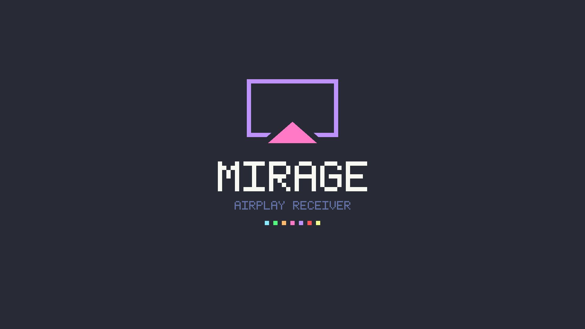

# Mirage

An AirPlay receiver for a jailbroken PS5. Pick the console from the AirPlay
menu of an iPhone, iPad or Mac and it plays the music, mirrors the screen or
plays the YouTube video you cast to it.

Unofficial homebrew. Not affiliated with Apple or Sony.



## What works

| | |
| --- | --- |
| Music (AirPlay audio) | Yes, with the sending device's volume, pause and skip |
| Screen mirroring | Yes, H.264 up to 1080p, hardware decoded, sound in sync, rotation |
| Casting from the YouTube app | Yes, up to 1080p60, with pause, seek and the right length on the phone |
| Videos from the Photos app | Yes; the phone sends them as a 1080p mirroring stream |
| PIN pairing | Optional, off by default |
| Opens by itself | Yes: with the payload loaded, picking the console opens the title; if a game is running you get a notification instead |

## What does not

- **DRM content** (Netflix, the Apple TV app, and the like). Not supported by
  the AirPlay library this is built on, and not planned.
- **Casting from apps other than YouTube.** Apps that draw their own video
  (VLC, for one) only hand AirPlay their sound; use screen mirroring for those.
- **HEVC, 4K and HDR.** Everything is H.264 at up to 1080p for now.
- Tested on one console only: a PS5 Pro on firmware 13.42. Other models and
  firmwares may work and have not been tried.

## Installing

A release has two files. Take either or both.

- **`PPSA99741.ffpfsc`**: the title, as an image for a homebrew loader such
  as [ShadowMountPlus](https://github.com/drakmor/ShadowMountPlus). It
  carries its own copy of the payload and starts it when you open Mirage. The
  payload keeps running after the title is closed, until the console restarts.
- **`mirage.elf`**: the payload alone, for an ELF loader (port 9021) or an
  autoloader, so that the receiver is there from the moment the console is
  up. It still needs the title installed: the payload does the networking,
  the title is what you see and hear. Sending the ELF again replaces the copy
  that is running.

The console's ELF loader has to be running in both cases: the title starts
the payload through it, and the payload opens the title through it.

The receiver is listed as `Mirage - <the console's name>`. The name comes from
the console's Remote Play service; if that is switched off it is plain
`Mirage`.

## Settings

The payload reads `/data/mirage/mirage.conf` when it starts and writes one
with the defaults if there is none.

```
pin = off
```

With `pin = on` a device has to enter a 4 digit code the first time it
connects. The code is shown on the TV, or in a notification if a game is
running. Devices that have paired are remembered in `/data/mirage/paired.txt`;
delete a line there to make a device pair again.

## Things to know

- With PIN pairing off, anything on your network can play to the console.
- The payload serves its log, read only, on TCP port 47011 to anyone on the
  network (`curl -s telnet://<console-ip>:47011`). It names the devices that
  connect. Pairing codes are kept out of it.
- A drag on YouTube's position bar lands on the keyframe before the place you
  let go, up to a few seconds earlier.
- HTTPS certificates are not checked when fetching a cast.

## How it is put together

Two processes, because neither can do the job alone on this console: a
payload cannot be heard (its AudioOut is silent) and the hardware video
decoder only works from a title, while a title cannot listen on the network.

- **The payload** (`src\`, `mirage.elf`) runs the AirPlay protocol
  ([UxPlay](https://github.com/FDH2/UxPlay)'s library), decodes the sound,
  fetches and demuxes casts with FFmpeg, and listens on loopback.
- **The title** (`title\`, PPSA99741) connects to it and plays the PCM
  through AudioOut, decodes the video with VideoDec2 and draws it.

`NOTES.md` is the working log: what was tried on the console, what each run
showed, and why things are the way they are. `src\pcm_link.h` describes the
messages between the two halves.

## Building

Windows with WSL. The payload builds with clang and the
[PS5 Payload SDK](https://github.com/ps5-payload-dev/sdk); the title builds in
WSL from [ps5-native-app-boilerplate](https://github.com/blackbearreloaded/ps5-native-app-boilerplate).
The paths the scripts expect, and the upstream commits everything was built
against, are in `NOTES.md` ("Build", and the table of references).

```powershell
python tools\make-art.py           # tile and backgrounds, once
.\tools\build.ps1                  # out\mirage.elf
.\tools\build-title.ps1            # out\title\PPSA99741
.\tools\build-title.ps1 -Ffpfsc    # and out\release\PPSA99741.ffpfsc
.\tools\test-player.ps1            # the title's player against a fake payload, on the PC
```

One line of UxPlay's library is patched at build time (`tools\build.ps1`
says which and why).

## Licence and credits

GPL-3.0-or-later; see `LICENSE`.

Built on [UxPlay](https://github.com/FDH2/UxPlay) (GPL-3.0),
[libplist](https://github.com/libimobiledevice/libplist) (LGPL-2.1),
[FFmpeg](https://ffmpeg.org/) and [OpenSSL](https://www.openssl.org/) as
packaged by [pacbrew](https://github.com/ps5-payload-dev/pacbrew-repo), the
[PS5 Payload SDK](https://github.com/ps5-payload-dev/sdk) and
[ps5-native-app-boilerplate](https://github.com/blackbearreloaded/ps5-native-app-boilerplate)
(GPL-3.0), whose renderer the title uses and whose selection sound it still
carries. [ProsperoLight](https://github.com/blackbearreloaded/ProsperoLight) and [EVO Player](https://github.com/sainsaji/EVO-PLAYER-PS5) were read for
how VideoDec2 and AudioOut are used on this console. The colours are
[Dracula](https://draculatheme.com).
